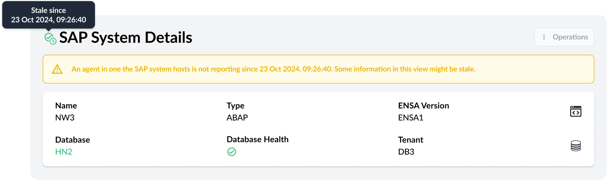
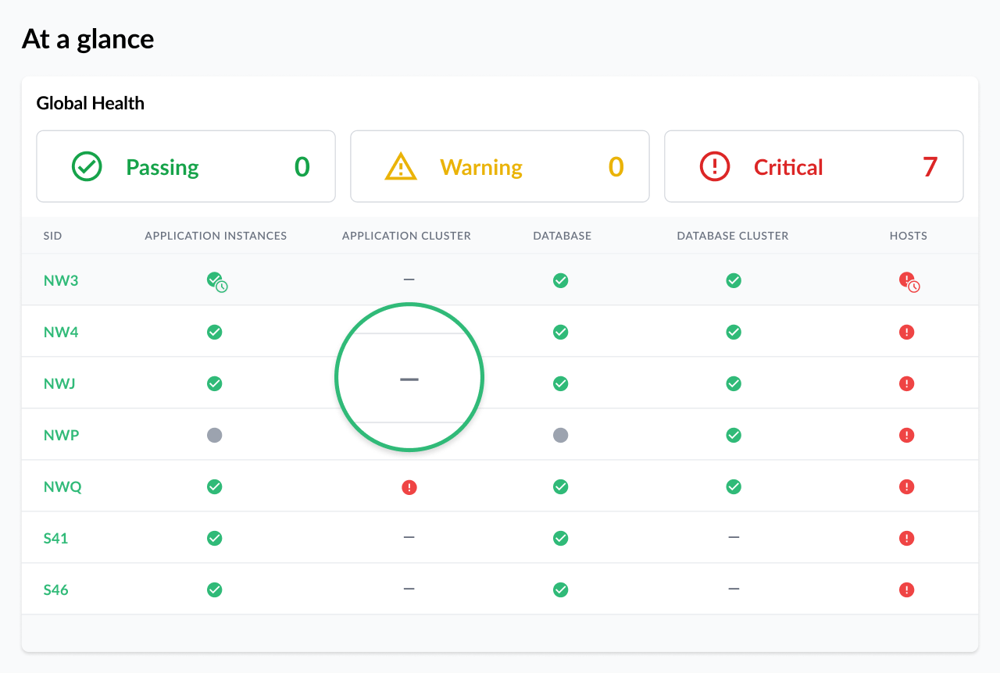
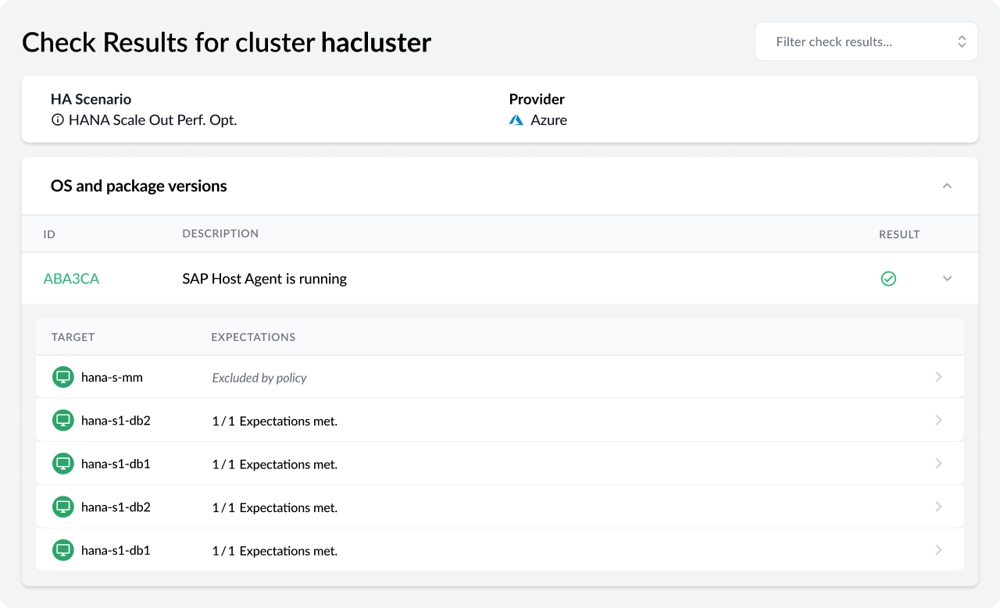

Trento 3.2 facilitates the adoption of AI capabilities with the introduction of Liz and it improves, significantly, user awareness in situations where agents are not reporting.

# Welcome Liz!
Liz is an embedded chat box that allows you to exploit Trento AI capabilities without the need for an external MCP client.

Do you want to know the tuning status of the hosts of your SAP environment? Ask Liz.
Do you want to know which hosts in your environment are affected by an important security patch? Ask Liz.
Do you want a summary of the checks execution results for one particular cluster, with step-by-step instructions on how to fix misconfigurations? Ask Liz.

Liz is nicely integrated in the Trento UI, with convenient sizing/location capabilities, and it produces elegant markdown-ready replies that you can copy and paste into any markdown compatible editor without any further need for additional formatting.



# Improved Status Handling When Agents Are Not Reporting
Trento agents may stop reporting to Trento Server at any given time for multiple reasons: a host crash, a network connectivity issue or a crash of the service itself. Version 3.2 introduces a stale status of things to handle this type of situation and to ensure that the user becomes immediately aware that there is an issue with one or more agents in their environment.

# Other Improvements
Version 3.2 brings additional improvements around observability:

* A better explanation of the aggregated health of the different components in the environment, both in the User Documentation and in the UI itself.
* A cleaner representation in the Dashboard of clusters when they are not present in the architecture.

* Decoupling of application instances’ overall status in dashboard from database status.
* The inclusion of the health of SBD devices in the aggregated health of pacemaker clusters using file-based SBD fencing.

The new version delivers a smarter check execution in clusters with nodes where no SAP workload is expected to be running. For example, HANA scale-out clusters with majority maker nodes.

Version 3.2 makes for a friendlier UI utilization with the addition of persistence on filters and number of items per page. Whatever filters and/or number of items a user sets in one particular view, they will remain unchanged until the user changes them again. These settings are session and tab bound.



The new version helps customers enable alert emails by allowing a test of the SMTP configuration. When the delivery of a test email fails, an entry in the activity log is generated providing the user with relevant information about the error that prevented the delivery.



Last but not least, version 3.2 allows the customer to easily adjust the logger level for the different Trento Server components. This helps the customer control the amount of storage used by the Trento logs during normal operations while enabling them to generate detailed logs when it’s required for issue troubleshooting.

# Aiming For Zero Vulnerabilities
Trento 3.2 consolidates a couple of processes that were introduced after the release of version 3.1 and that are aimed to minimize the number of vulnerabilities present in the Trento application, regardless of the deployment choice for Trento Server: container based or RPM based.

First, a patch release will be released on a monthly basis moving forward. This patch release will include fixes for vulnerabilities detected during regular application scans as well as fixes for bugs detected internally or reported by customers. It will be delivered as new RPMs, and new container images when applicable.

Second, the Trento container images are subject to a continuous rebuild process. Whenever a vulnerability is detected in the base image, a new base image is generated fixing that vulnerability, and new Trento container images are generated using the new base image. This update does not carry a Trento version change and does not impact, obviously, RPMs.

# Are you wanting to upgrade or try out Trento?
Follow the [instructions in our documentation](https://documentation.suse.com/sles-sap/trento/single-html/SLES-SAP-trento/index.html "Getting started with Trento") to get started.
